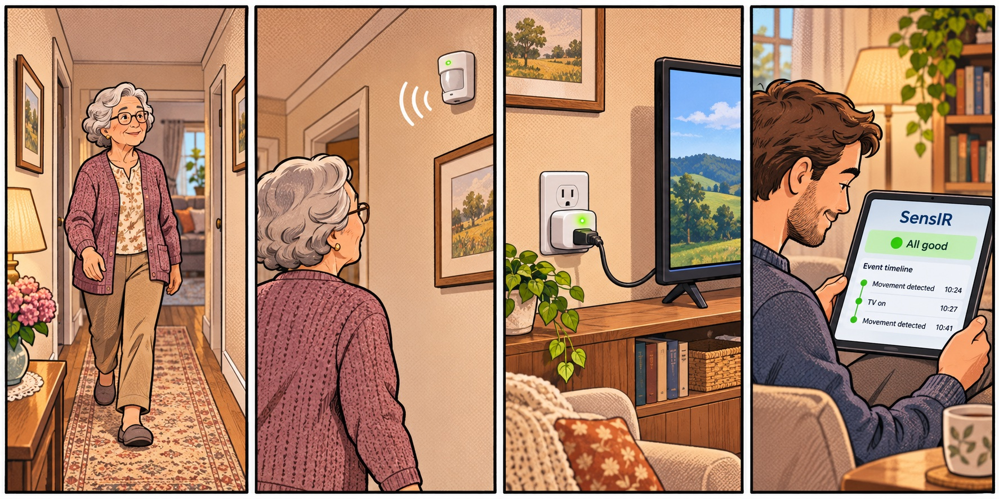
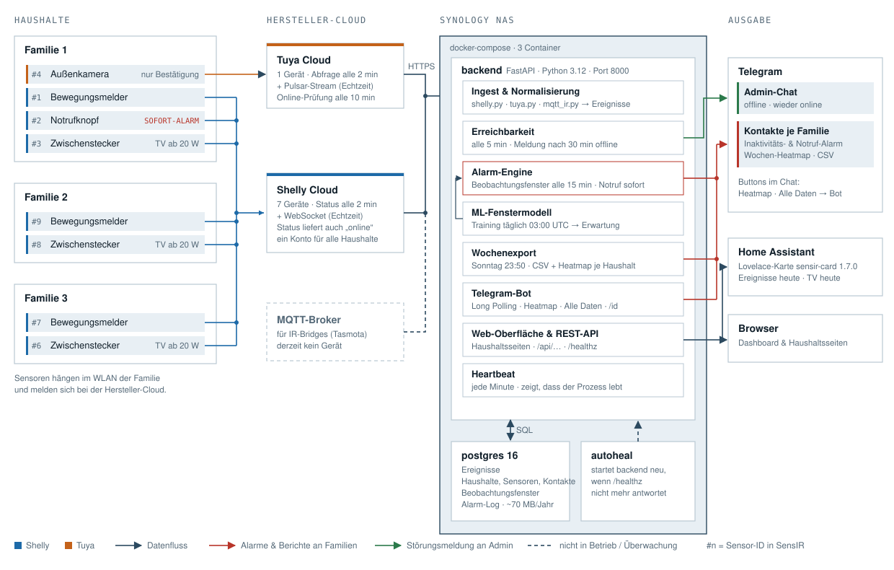

# SensIR

"Babyphone für Senioren ohne Bild und Ton" — Sensoren melden Alltags­aktivität
einer älteren Person. Bleibt die erwartete Aktivität in einem Zeitfenster aus,
werden Angehörige per Telegram alarmiert. Ein KI-Modell lernt pro Haushalt den
normalen Tagesablauf und ersetzt nach und nach die manuell konfigurierten
Zeitfenster.



**SensIR mit Telegram und Shelly-Hardware für einmalig rund 35 € pro Haushalt:**
ein Shelly-Bewegungsmelder meldet, dass sich die Person in der Wohnung bewegt,
ein Shelly-Zwischenstecker zeigt, wann der Fernseher läuft, und die Angehörigen
bekommen per Telegram Bescheid, wenn das gewohnte Lebenszeichen ausbleibt.
Keine Kamera, kein Mikrofon, kein Abo. Schritt für Schritt:
**[HowTo: SensIR mit Shelly-Komponenten](#howto-sensir-mit-shelly-komponenten)**.

**Ein Backend, drei austauschbare Sensor-Quellen:**

| Quelle | Geräte | Weg |
|---|---|---|
| `ir_bridge` | Pearl-IR-Empfänger mit Tasmota ("YTF IR Bridge") neben dem Fernseher | MQTT im LAN / über Broker |
| `tuya` | Tuya-/SmartLife-Geräte (Bewegungsmelder, Tür­kontakte, Rauchmelder, Steckdosen mit Verbrauchsmessung) | Tuya Cloud API + Pulsar-Stream |
| `shelly` | Shelly-Geräte (**BLU Motion + Plug M Gen3** als Standard, außerdem Plug S, BLU Button, i4, Smoke) | Shelly Cloud API + Cloud-WebSocket |

Alle Quellen schreiben dasselbe kanonische `SensorEvent`. ML, Alerting und
Status arbeiten quellenunabhängig — ein Haushalt kann Geräte mehrerer Marken
gemischt haben.

Hintergrund, Personas, Business Model Canvas etc. siehe die Projekt-Doku
(nicht Teil dieses Repos).

## HowTo: SensIR mit Shelly-Komponenten

Das ist der Standardaufbau, mit dem SensIR derzeit in den Haushalten läuft.

### 1. Hardware pro Haushalt (einmalig rund 35 €)

| Gerät | Aufgabe in SensIR |
|---|---|
| [Shelly BLU Motion ZB](https://www.shelly.com/de/products/shelly-blu-motion-zb) | Bewegungsmelder, batteriebetrieben. Jede Bewegung ist ein Lebenszeichen. |
| [Shelly Plug M Gen3](https://www.shelly.com/de/products/shelly-plug-m-gen3-white) | Zwischenstecker für den Fernseher. Misst die Leistung und meldet „TV an/aus“. Verbindet außerdem den Bewegungsmelder per Bluetooth mit der Shelly Cloud. |

Im Haushalt braucht es nur WLAN mit Internetzugang. Ein eigener Server, ein Hub
oder ein Abo beim Hersteller ist dort nicht nötig.

### 2. Geräte im Haushalt einrichten

1. Den Zwischenstecker in die Steckdose des Fernsehers stecken und den
   Fernseher daran anschließen.
2. Den Zwischenstecker in der App **Shelly Smart Control** ins WLAN des
   Haushalts bringen. Alle Haushalte nutzen dasselbe Shelly-Konto, damit
   SensIR mit einem einzigen Cloud-Schlüssel alle Geräte sieht.
3. Den Bewegungsmelder in derselben App hinzufügen und ihn dem Zwischenstecker
   als Bluetooth-Gateway zuordnen.
4. Den Bewegungsmelder dort anbringen, wo die Person jeden Tag vorbeikommt,
   zum Beispiel im Flur oder an der Küchentür.
5. Den Geräten sprechende Namen geben, zum Beispiel
   `familie-1-bewegungsmelder` und `familie-1-zwischenstecker`. Unter diesen
   Namen erscheinen sie später in SensIR.

### 3. SensIR einmal zentral starten

SensIR läuft an einer Stelle für alle Haushalte, zum Beispiel per Docker auf
einem NAS. In `.env` (Vorlage: `.env.example`):

```bash
SHELLY_ENABLED=true
SHELLY_AUTH_KEY=...        # Shelly-App → Einstellungen → Autorisierungs-Cloud-Key
SHELLY_API_HOST=...        # Server-Host von derselben Seite
TELEGRAM_BOT_TOKEN=...     # von @BotFather
ADMIN_TELEGRAM_CHAT_ID=... # optional: Meldung, wenn ein Gerät offline geht
```

Dann `docker compose up -d --build`. Die Weboberfläche läuft auf Port 8000.

### 4. Telegram-Bot anlegen

1. Bei [@BotFather](https://t.me/BotFather) einen Bot anlegen und das Token in
   `TELEGRAM_BOT_TOKEN` eintragen.
2. Jeder Angehörige öffnet den Bot, drückt **Starten**, schreibt `/id` und
   bekommt seine Chat-ID zurück. Wie andere den Bot finden, steht unter
   [Weitere Angehörige hinzufügen](#weitere-angehörige-hinzufügen).

### 5. Haushalt in SensIR anlegen

1. In der Weboberfläche **+ Neuen Haushalt anlegen**, Name und Zeitzone
   eintragen.
2. Unter **Shelly-Geräte** den Bewegungsmelder und den Zwischenstecker
   auswählen.
3. Die Angehörigen mit ihrer Telegram-Chat-ID als Kontakte eintragen.
4. Auf der Haushaltsseite **Testnachricht senden** drücken. Kommt die Nachricht
   bei allen an, erreichen sie auch die Alarme.
5. Die TV-Schwelle auf 20 W setzen, damit Standby-Spitzen nicht als
   Fernsehzeit zählen (Standard sind 10 W; die Sensor-ID steht in
   `GET /api/sensors`):

   ```bash
   curl -X PATCH http://<sensir-host>:8000/api/sensors/<id> \
     -H 'Content-Type: application/json' -d '{"config":{"on_threshold_w":20}}'
   ```

   `config` wird dabei komplett ersetzt. Hat der Sensor schon andere
   Einträge (zum Beispiel `room`), diese mit angeben.

### 6. Was danach passiert

- **Bewegung** zählt als Lebenszeichen. Bleibt sie im erwarteten Zeitfenster
  aus, bekommen alle aktiven Kontakte eine Telegram-Nachricht. Nach einigen
  Wochen lernt SensIR den normalen Tagesablauf selbst.
- **Fernsehzeiten** erscheinen als Balken in der Tages- und Wochenansicht, in
  der Home-Assistant-Karte und im Wochenbild. Als Lebenszeichen zählen sie
  bewusst nicht, denn jemand kann auch hilflos vor dem laufenden Fernseher
  liegen.
- **Jeden Sonntag um 23:50** kommen Wochen-Heatmap und CSV per Telegram. Die
  Tasten **Heatmap** und **Alle Daten** im Chat liefern sie jederzeit.
- **Geht ein Gerät offline**, zum Beispiel weil der Stecker gezogen wurde,
  meldet SensIR das nach 30 Minuten dem Admin-Chat und gibt Entwarnung, sobald
  es wieder da ist.

## Architektur

```
 IR-Bridge (Tasmota)     Tuya-/SmartLife-Geräte     Shelly-Geräte
        │ MQTT                  │ Tuya Cloud              │ Shelly Cloud
        ▼                       ▼                         ▼
 externer MQTT-Broker     openapi.tuya*.com          shelly-*.shelly.cloud
 (öffentlich erreichbar,     + Pulsar-Stream            + Cloud-WebSocket
  eigener Server/DynDNS)
        └───────────────┬───────┴─────────────────────────┘
                        ▼
   FastAPI Backend
   ├─ ingest/registry.py  → startet die aktiven Quellen (ENV-Flags)
   │   ├─ mqtt_ir.py       → SensorEvent(kind="ir")
   │   ├─ tuya.py          → Polling + Pulsar → normalize → SensorEvent
   │   └─ shelly.py        → Polling + WebSocket → normalize → SensorEvent
   ├─ scheduler.py         → APScheduler: periodische Prüfung + nächtliches ML-Training
   ├─ alerting/engine.py   → Zeitfenster-Check + sofortige Rauch-/Gas-Alarme
   ├─ ml/window_model.py   → KernelDensity je Haushalt (über alle SensorEvents)
   ├─ alerting/telegram.py → Alarme an konfigurierte Kontakte
   ├─ api/                 → REST (Haushalte, Sensoren, Quellen-Discovery, Kontakte, Zeitfenster, Status)
   └─ web/                 → Dashboard (Ampel, Ereigniszahl und Tagesgrafik je Haushalt)
        │
        ▼
   Postgres (Events, Konfiguration, Historie)
```

Grafischer Systemplan mit allen Komponenten (Sensoren, Clouds, Container,
Ausgabekanäle) — [docs/systemplan.html](docs/systemplan.html) als Seite mit
Bauteilliste:



## Voraussetzungen

**Für den Standardaufbau mit Shelly** (siehe
[HowTo](#howto-sensir-mit-shelly-komponenten)):

- Docker + Docker Compose an einer zentralen Stelle, zum Beispiel auf einem NAS
- Pro Haushalt ein [Shelly BLU Motion ZB](https://www.shelly.com/de/products/shelly-blu-motion-zb)
  als Bewegungsmelder und ein
  [Shelly Plug M Gen3](https://www.shelly.com/de/products/shelly-plug-m-gen3-white)
  als Zwischenstecker für den Fernseher, zusammen einmalig rund 35 €
- WLAN mit Internetzugang im Haushalt
- Ein Shelly-Cloud-Konto für alle Haushalte (Cloud-Key aus der Shelly-App)
- Ein Telegram-Bot (über @BotFather) und Telegram bei den Angehörigen

**Optional für IR-Bridges** (älterer Aufbau, derzeit nicht im Einsatz):

- Ein oder mehrere Pearl-IR-Fernbedienungen mit Tasmota-Firmware
  (Modul-Typ "YTF IR Bridge (62)"), siehe `Pearl-IR-Sender-Tasmota.pdf` für
  die Flash-Anleitung.
- Ein von außen erreichbarer MQTT-Broker (kein Bestandteil dieses
  Compose-Stacks — die IR-Bridges sitzen in verschiedenen, entfernten
  Haushalten ohne Port-Forwarding zum Hosting-Server). Praktisch: der
  eigene Broker hinter einer DynDNS-Adresse (z. B. AVM MyFRITZ!), mit
  einem gemeinsamen Benutzer für alle Haushalte — die Trennung passiert
  über `mqtt_topic` pro Sensor, nicht über MQTT-User.

## Setup

```bash
cp .env.example .env
# .env anpassen: Postgres-Passwort, externer MQTT-Broker (Host/Port/User/PW),
# Telegram-Bot-Token

docker compose up --build
```

Die erste Migration wird beim Start automatisch ausgeführt
(`alembic upgrade head` im Backend-Container). Dashboard danach unter
`http://localhost:8000/`, API-Dokumentation unter `http://localhost:8000/docs`.

## Neuen Haushalt anlegen, Sensoren pflegen, Haushalt löschen

Am einfachsten über die Web-Oberfläche: "+ Neuen Haushalt anlegen" im
Dashboard (`/onboarding`) führt in drei Schritten durch Haushalt →
Sensoren (Tuya/Shelly-Geräte zum Ankreuzen, IR-Bridge manuell) → Kontakt +
Testnachricht. Auf jeder Haushaltsseite lassen sich danach jederzeit
weitere Sensoren hinzufügen, umbenennen, aktivieren/deaktivieren oder
entfernen, und der ganze Haushalt löschen (mit Cascade auf alle
zugehörigen Daten). Die Detailseite zeigt oberhalb der Sensoren eine
Tagesgrafik mit Ereigniszeitpunkten und Stundenbalken sowie eine
Wochen-Heatmap (Montag bis Sonntag) mit Ereignissen pro Stunde. Beide
Grafiken aktualisieren sich alle 30 Minuten. Ausführliche Beschreibung mit jedem Klickpfad und
Sonderfall: **[docs/haushalte-verwalten.md](docs/haushalte-verwalten.md)**.

Alternativ manuell per API, siehe unten.

## Einen Sensor anlernen

1. Tasmota-Gerät wie in `Pearl-IR-Sender-Tasmota.pdf` beschrieben flashen
   und einrichten. Modul-Typ "YTF IR Bridge (62)", MQTT-Server/Port/Zugangsdaten
   auf den externen Broker aus `.env` (`MQTT_HOST`/`MQTT_PORT`) zeigen lassen —
   nicht auf die Synology, die IR-Bridge braucht die öffentlich erreichbare
   Broker-Adresse. Der Tasmota-Topic-Name (Configuration → MQTT → Topic) muss
   pro Haushalt eindeutig sein (z. B. `sensir-<haushalt>-01`) und ist der
   `mqtt_topic` unten.
2. Sensor + Haushalt in SensIR anlegen:

   ```bash
   curl -X POST localhost:8000/api/households -d '{"name": "Hannelore Meyer"}' -H 'Content-Type: application/json'
   # IR-Bridge:
   curl -X POST localhost:8000/api/sensors -d '{"household_id":1,"name":"Wohnzimmer","kind":"ir_bridge","mqtt_topic":"sensir-01"}' -H 'Content-Type: application/json'
   ```
3. Kontakte und (optional, siehe unten) Zeitfenster über das Dashboard
   unter `/households/1` anlegen.

## Tuya-/SmartLife-Geräte anbinden

1. Auf [iot.tuya.com](https://iot.tuya.com) ein Konto + **Cloud-Projekt** anlegen
   (Data Center = Region der SmartLife-App, EU meist `Central Europe`).
   APIs *IoT Core*, *Authorization*, *Device Status Notification* abonnieren.
2. **Devices → Link App Account** → QR-Code mit der SmartLife-App der Person
   scannen. Die *UID* dort ist `TUYA_APP_ACCOUNT_UID`.
3. In `.env`: `TUYA_ENABLED=true`, `TUYA_ACCESS_ID/SECRET`, `TUYA_REGION`,
   `TUYA_APP_ACCOUNT_UID`. Neustart.
4. Geräte auflisten und als Sensor anlegen:

   ```bash
   curl localhost:8000/api/sources/tuya/devices
   curl -X POST localhost:8000/api/sensors -H 'Content-Type: application/json' \
     -d '{"household_id":1,"name":"Flur Bewegung","kind":"tuya","external_id":"<device-id>","config":{"room":"flur"}}'
   # Steckdose mit Verbrauchsmessung: "config":{"room":"kueche","on_threshold_w":15}
   ```

**IPC-Kameras** (Bewegungsalarme) brauchen zwei zusätzliche Freischaltungen im
Tuya-Projekt (Messaging Rule für die Production-Umgebung + „Camera Service"
abonnieren) und laufen intern über einen anderen Ereignis-Code/Nachrichten-
format als normale Sensoren — ausführliche Schritt-für-Schritt-Anleitung:
[`docs/tuya-camera-motion-troubleshooting.md`](docs/tuya-camera-motion-troubleshooting.md).

## Shelly-Geräte anbinden

1. Shelly-App/Cloud → **Einstellungen → Autorisierungs-Cloud-Key**. Dort stehen
   der Key und der Server-Host (z. B. `https://shelly-59-eu.shelly.cloud`).
2. In `.env`: `SHELLY_ENABLED=true`, `SHELLY_AUTH_KEY`, `SHELLY_API_HOST`.
   Neustart.
3. `curl localhost:8000/api/sources/shelly/devices`, dann Sensor mit
   `"kind":"shelly","external_id":"<device-id>"` anlegen.

Rauch-/Gasmelder (Tuya oder Shelly) lösen unabhängig vom Zeitfenster sofort
einen Telegram-Alarm an alle Kontakte aus.

## Zeitfenster: manuell vs. KI

Ohne konfiguriertes Zeitfenster gilt der Default aus `.env`
(`DEFAULT_WINDOW_START/END/MIN_ACTIONS`). Sobald ein Haushalt
`ML_MIN_SAMPLES` (Default 200) IR-Ereignisse gesammelt hat, übernimmt beim
nächsten nächtlichen Training (`ML_TRAIN_HOUR_UTC`) automatisch das
gelernte Modell aus `app/ml/window_model.py` die Erwartungswert-Berechnung —
die manuell gepflegten `ObservationWindow`-Einträge dienen dann nur noch
als Fallback für neue/verwaiste Haushalte.

## Telegram-Bot

Bot bei [@BotFather](https://t.me/BotFather) anlegen, Token in
`TELEGRAM_BOT_TOKEN` eintragen. Die Person schreibt dem Bot `/id`; die Antwort
enthält ihre Chat-ID, die beim SensIR-Kontakt eingetragen wird.

Im Chat zeigt der Bot zwei Tasten (nach `/start` sichtbar):

- **Heatmap** (oder `/heatmap`): die Wochenbilder aller aktiven Familien
- **Alle Daten** (oder `/daten`): je aktiver Familie eine CSV mit allen
  bisher gespeicherten Ereignissen

Beide Tasten funktionieren nur, wenn der Chat in **jeder** aktiven Familie als
aktiver Telegram-Kontakt hinterlegt ist. Alarme bekommt ein Kontakt dagegen
für jede Familie, bei der er eingetragen ist.

### Weitere Angehörige hinzufügen

Ein Telegram-Bot darf nur Leuten schreiben, die ihn vorher selbst gestartet
haben. Neue Angehörige gehen deshalb so vor:

1. **Benutzernamen des Bots finden:** In Telegram den Chat mit dem SensIR-Bot
   öffnen und oben auf seinen Namen tippen. Im Profil steht der Benutzername
   mit `@`, zum Beispiel `@MeinSensirBot` (Bot-Namen enden immer auf „bot“).
   Alternativ zeigt [@BotFather](https://t.me/BotFather) mit `/mybots` alle
   eigenen Bots an.
2. **Link schicken:** `https://t.me/MeinSensirBot` (echter Name, ohne `@`)
   an die Person schicken, oder im Bot-Profil über das Menü **Teilen**
   weiterleiten.
3. **Bot starten:** Die Person tippt auf den Link, drückt **Starten** und
   schreibt `/id`. Der Bot antwortet mit ihrer Chat-ID.
4. **Als Kontakt eintragen:** Auf der Haushaltsseite unter **Kontakte** Name
   und Telegram-Chat-ID eintragen und **Kontakt hinzufügen** klicken. Soll die
   Person für mehrere Familien Alarme bekommen, auf jeder dieser
   Haushaltsseiten eintragen.
5. **Testen:** Oben auf der Haushaltsseite **Testnachricht senden** klicken.
   Die Seite zeigt danach, an wie viele Kontakte die Nachricht ging.

Den Bot-Link kann jeder öffnen, das ist unbedenklich: Wer den Bot startet,
sieht nur seine eigene Chat-ID. Alarme, Heatmaps und Daten gehen
ausschließlich an Chats, die in SensIR als Kontakt eingetragen sind.

## Home Assistant Lovelace-Karte

`www/sensir-card.js` zeigt eine Ampel-Übersicht aller Haushalte direkt in
einem Home-Assistant-Dashboard — Status auf einen Blick, ein Pfeil klappt
die letzten Ereignisse je Haushalt auf/zu, Klick auf den Namen öffnet die
volle sensir-Seite in neuem Tab. Fragt die sensir-API direkt aus dem
Browser ab, braucht also keine eigene HA-Integration.

```yaml
type: custom:sensir-card
base_url: http://<sensir-host>:8000   # erforderlich
```

Setup (CORS freischalten, Datei nach `/config/www/` kopieren, als
Lovelace-Ressource eintragen): siehe **[sensir.md, Abschnitt 9.1](sensir.md#91-home-assistant-lovelace-karte-wwwsensir-cardjs)**.

## Wöchentlicher CSV-Datenexport

Einmal pro Woche bekommt jeder Haushalt automatisch eine CSV mit allen
Sensor-Rohereignissen der letzten 7 Tage per Telegram zugeschickt (Grundlage
für eigenes ML-Training) — `WEEKLY_EXPORT_*` in `.env`, sofort auslösbar über
`POST /api/households/{id}/export`. Details: **[sensir.md, Abschnitt 5.4](sensir.md#54-wöchentlicher-csv-rohdaten-export-appexportpy)**.

Auf der Haushaltsübersicht verschickt der Button **„Heatmap an Telegram senden“**
für jede aktive Familie ein Wochen-Heatmap-Bild an deren aktive Telegram-Kontakte.
Die Grafik zeigt Ereignisse je Stunde von Montag bis Sonntag.

## Bekannte Lücken / nächste Schritte

- **Sensor-Sicherheit**: aktuell MQTT-Benutzername/Passwort ohne TLS, und
  ein gemeinsamer Broker-User für alle Haushalte (PoC-Entscheidung, siehe
  sensir.md 4.1/9). Für den produktiven Rollout: MQTTS mit
  Client-Zertifikat pro Sensor (Tasmota unterstützt das nativ) und/oder
  Broker-ACLs pro Topic-Präfix, damit ein Haushalt nicht die Topics eines
  anderen abhören/fälschen kann.
- **ML-Modell**: keine Mitternachts-Wraparound-Behandlung im
  KernelDensity-Fenster — für die Zielgruppe (abendliches Fernsehen) bisher
  unkritisch, siehe Docstring in `app/ml/window_model.py`.
- **Contact-Onboarding**: `telegram_chat_id` wird aktuell manuell ermittelt
  und eingetragen, kein Self-Service-Flow.
- Aus der Projekt-Doku vorgemerkte Erweiterungen: Remote-Fernbedienung des
  Senioren-TVs, Temperatur-/Feuchtigkeitssensor (Schimmelwarnung),
  Alzheimer-Früherkennung durch Langzeit-Beobachtung.

## Entwicklung ohne Docker

```bash
cd backend
python -m venv .venv && source .venv/bin/activate
pip install -r requirements.txt
# .env im Projekt-Root muss auf eine lokal erreichbare Postgres-Instanz zeigen
alembic upgrade head
uvicorn app.main:app --reload
```
