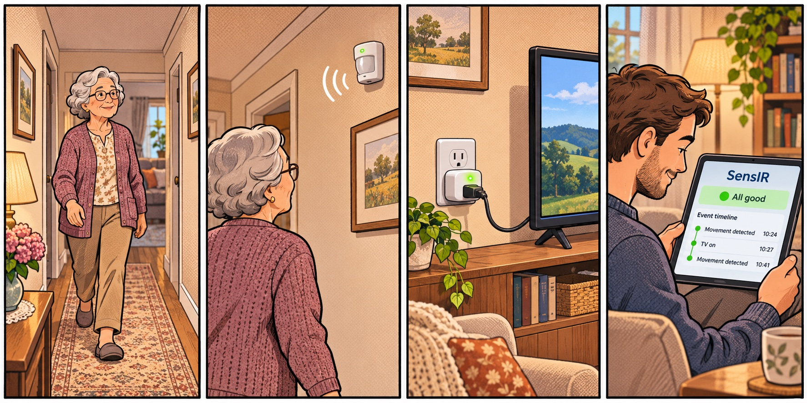
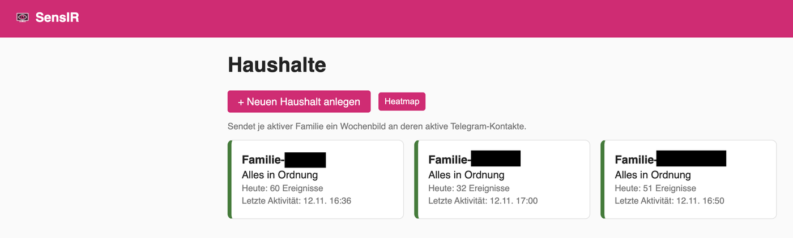
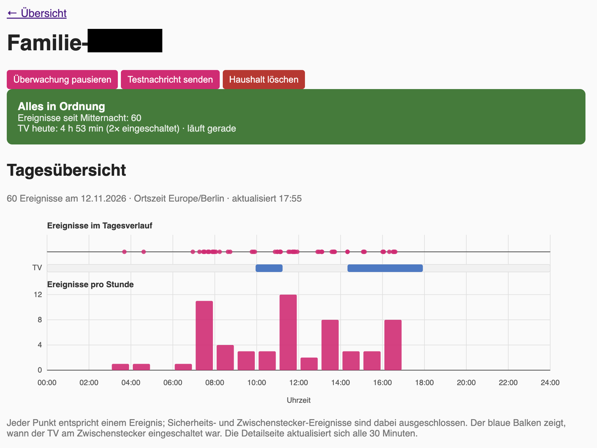
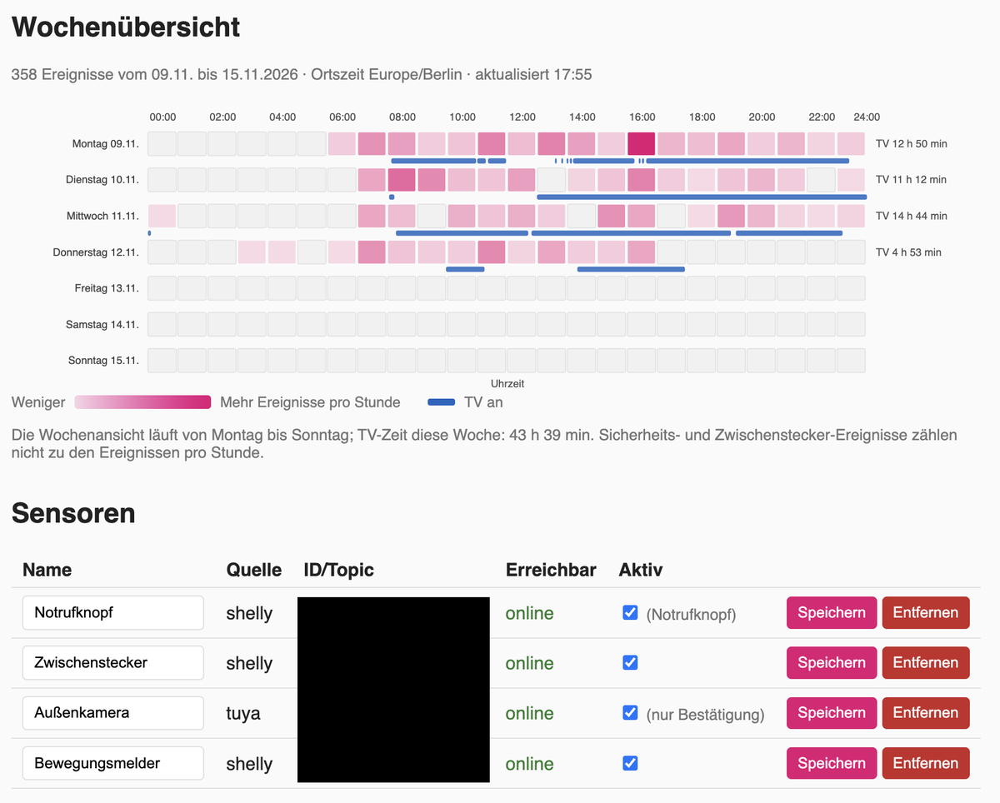
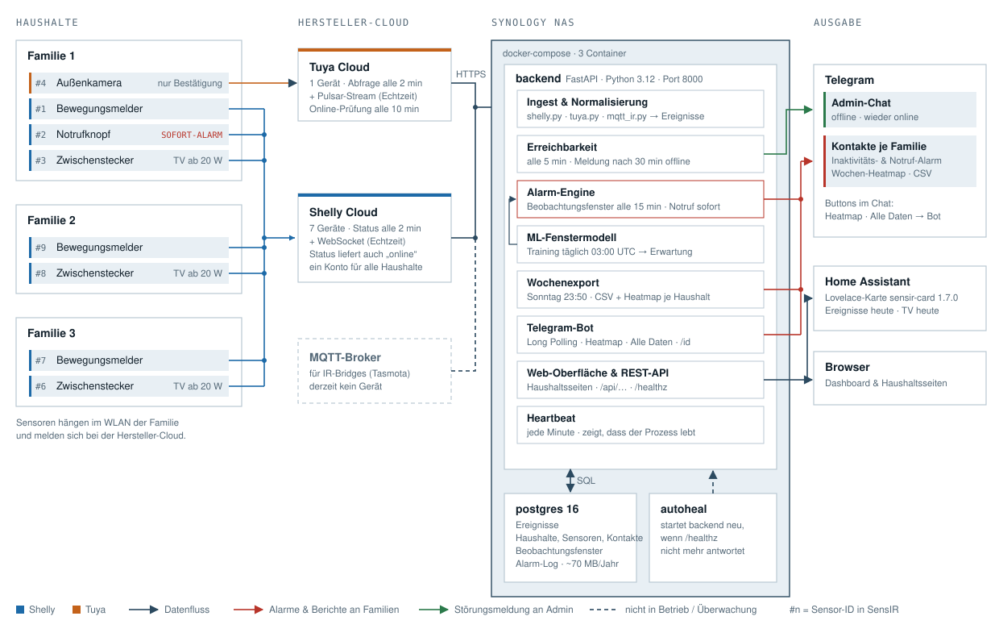
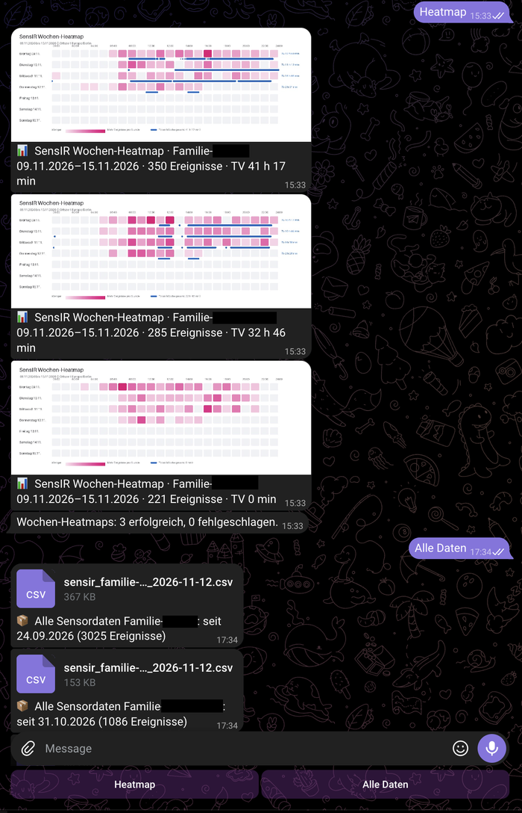
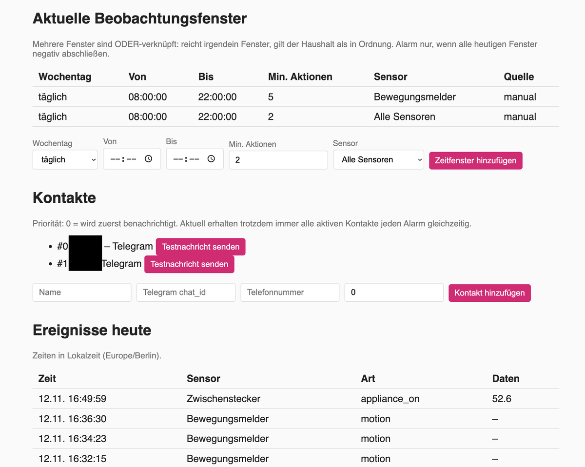
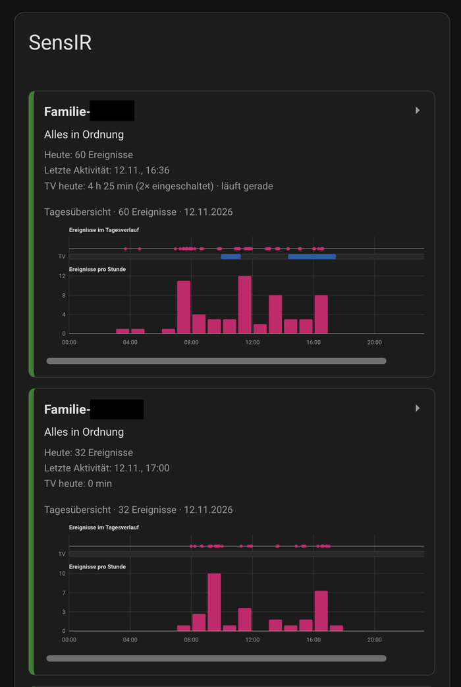
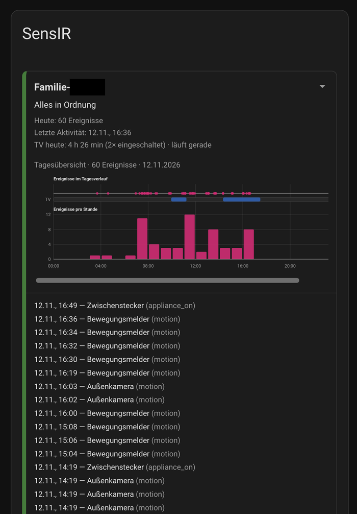

# SensIR

[🇩🇪 Deutsch](README.md) · 🇬🇧 English

"A baby monitor for seniors – without picture or sound." Sensors report the
everyday activity of an elderly person. If the expected activity doesn't happen
within a time window, relatives are alerted via Telegram. An AI model learns
each household's normal daily routine and gradually replaces the manually
configured time windows.

> The web interface, Telegram messages and the detailed documentation are in German.



**SensIR with Telegram and Shelly hardware for a one-off cost of about €35 per household:**
a Shelly motion sensor reports that the person is moving around the home,
a Shelly smart plug shows when the TV is on, and the relatives
are notified via Telegram when the usual sign of life doesn't come.
No camera, no microphone, no subscription. Step by step:
**[HowTo: SensIR with Shelly components](#howto-sensir-with-shelly-components)**.

**One backend, three interchangeable sensor sources:**

| Source | Devices | Path |
|---|---|---|
| `ir_bridge` | Pearl IR receiver with Tasmota ("YTF IR Bridge") next to the TV | MQTT on the LAN / via broker |
| `tuya` | Tuya/SmartLife devices (cameras with motion detection such as LSC Smart Connect, motion sensors, door contacts, smoke detectors, plugs with power metering) | Tuya Cloud API + Pulsar stream |
| `shelly` | Shelly devices (**BLU Motion + Plug M Gen3** as the default, also Plug S, BLU Button, i4, Smoke) | Shelly Cloud API + cloud WebSocket |

All sources write the same canonical `SensorEvent`. ML, alerting and
status work independently of the source — a household can mix devices from
several brands.

Background, personas, business model canvas etc. are in the project documentation
(not part of this repo).

## HowTo: SensIR with Shelly components

This is the standard setup SensIR currently runs on in the households.

### 1. Hardware per household (one-off about €35)

| Device | Role in SensIR |
|---|---|
| [Shelly BLU Motion ZB](https://www.shelly.com/de/products/shelly-blu-motion-zb) | Battery-powered motion sensor. Every movement is a sign of life. |
| [Shelly Plug M Gen3](https://www.shelly.com/de/products/shelly-plug-m-gen3-white) | Smart plug for the TV. Measures power and reports "TV on/off". Also connects the motion sensor to the Shelly Cloud via Bluetooth. |

The household only needs Wi-Fi with internet access. No server, hub
or manufacturer subscription is needed there.

### 2. Setting up the devices in the household

1. Plug the smart plug into the TV's socket and connect the
   TV to it.
2. Add the smart plug to the household's Wi-Fi in the **Shelly Smart Control** app.
   All households use the same Shelly account, so
   SensIR sees all devices with a single cloud key.
3. Add the motion sensor in the same app and assign it to the smart plug
   as its Bluetooth gateway.
4. Mount the motion sensor where the person passes every day,
   for example in the hallway or at the kitchen door.
5. Give the devices descriptive names, for example
   `familie-1-bewegungsmelder` (family 1 motion sensor) and `familie-1-zwischenstecker` (family 1 smart plug).
   They appear in SensIR under these names.

### 3. Start SensIR once, centrally

SensIR runs in one place for all households, for example via Docker on
a NAS. In `.env` (template: `.env.example`):

```bash
SHELLY_ENABLED=true
SHELLY_AUTH_KEY=...        # Shelly app → Settings → Authorization cloud key
SHELLY_API_HOST=...        # Server host from the same page
TELEGRAM_BOT_TOKEN=...     # from @BotFather
ADMIN_TELEGRAM_CHAT_ID=... # optional: notification when a device goes offline
```

Then `docker compose up -d --build`. The web interface runs on port 8000.

### 4. Create the Telegram bot

1. Create a bot with [@BotFather](https://t.me/BotFather) and put the token in
   `TELEGRAM_BOT_TOKEN`.
2. Each relative opens the bot, taps **Start**, writes `/id` and
   gets their chat ID back. How others find the bot is described under
   [Adding more relatives](#adding-more-relatives).

### 5. Create the household in SensIR



1. In the web interface click **+ Neuen Haushalt anlegen** (add new household), enter name and
   time zone.
2. Under **Shelly-Geräte** (Shelly devices), select the motion sensor and the smart plug.
3. Enter the relatives with their Telegram chat ID as contacts.
4. On the household page, click **Testnachricht senden** (send test message). If the message
   reaches everyone, the alarms will reach them too.
5. Set the TV threshold to 20 W so standby spikes don't count as
   TV time (default is 10 W; the sensor ID is in
   `GET /api/sensors`):

   ```bash
   curl -X PATCH http://<sensir-host>:8000/api/sensors/<id> \
     -H 'Content-Type: application/json' -d '{"config":{"on_threshold_w":20}}'
   ```

   `config` is replaced completely. If the sensor already has other
   entries (for example `room`), include them too.

### 6. What happens next





- **Movement** counts as a sign of life. If it doesn't occur within the expected time window,
  all active contacts get a Telegram message. After a few
  weeks SensIR learns the normal daily routine by itself.
- **TV times** appear as bars in the daily and weekly views, in
  the Home Assistant card and in the weekly image. They deliberately do not count
  as a sign of life, because someone could also be lying helpless in front of a running TV.
- **Every Sunday at 23:50** the weekly heatmap and a CSV arrive via Telegram. The
  **Heatmap** and **Alle Daten** (all data) buttons in the chat deliver them at any time.
- **If a device goes offline**, for example because the plug was pulled,
  SensIR reports this to the admin chat after 30 minutes and gives the all-clear as soon as
  it's back.

## Architecture

```
 IR bridge (Tasmota)     Tuya/SmartLife devices      Shelly devices
        │ MQTT                  │ Tuya Cloud              │ Shelly Cloud
        ▼                       ▼                         ▼
 external MQTT broker     openapi.tuya*.com          shelly-*.shelly.cloud
 (publicly reachable,        + Pulsar stream            + cloud WebSocket
  own server/DynDNS)
        └───────────────┬───────┴─────────────────────────┘
                        ▼
   FastAPI backend
   ├─ ingest/registry.py  → starts the active sources (ENV flags)
   │   ├─ mqtt_ir.py       → SensorEvent(kind="ir")
   │   ├─ tuya.py          → polling + Pulsar → normalize → SensorEvent
   │   └─ shelly.py        → polling + WebSocket → normalize → SensorEvent
   ├─ scheduler.py         → APScheduler: periodic check + nightly ML training
   ├─ alerting/engine.py   → time window check + immediate smoke/gas alarms
   ├─ ml/window_model.py   → KernelDensity per household (across all SensorEvents)
   ├─ alerting/telegram.py → alarms to configured contacts
   ├─ api/                 → REST (households, sensors, source discovery, contacts, time windows, status)
   └─ web/                 → dashboard (traffic light, event count and daily chart per household)
        │
        ▼
   Postgres (events, configuration, history)
```

Graphical system diagram with all components (sensors, clouds, containers,
output channels) — [docs/systemplan.html](docs/systemplan.html) as a page with
a parts list:



## Requirements

**For the standard setup with Shelly** (see
[HowTo](#howto-sensir-with-shelly-components)):

- Docker + Docker Compose in one central place, for example on a NAS
- Per household one [Shelly BLU Motion ZB](https://www.shelly.com/de/products/shelly-blu-motion-zb)
  as a motion sensor and one
  [Shelly Plug M Gen3](https://www.shelly.com/de/products/shelly-plug-m-gen3-white)
  as a smart plug for the TV, together a one-off of about €35
- Wi-Fi with internet access in the household
- One Shelly Cloud account for all households (cloud key from the Shelly app)
- A Telegram bot (via @BotFather) and Telegram on the relatives' phones

**Optional for Tuya/SmartLife devices** (for example cameras with
motion detection; setup under
[Connecting Tuya/SmartLife devices](#connecting-tuyasmartlife-devices)):

- Tuya/SmartLife devices, for example the inexpensive
  [LSC Smart Connect solar camera from Action](https://www.action.com/de-de/p/3225729/lsc-smart-connect-solar-kamera/).
  LSC Smart Connect devices run on the Tuya platform and can be added in
  the SmartLife app.
- The SmartLife app at the observed person's home
- A free developer account with a cloud project on
  [iot.tuya.com](https://iot.tuya.com). The trial quota there must be
  renewed regularly; SensIR reminds you in the dashboard
  (`TUYA_TRIAL_EXPIRES` in `.env`).
- Tip: Register an outdoor camera as "confirmation only"
  (`config.confirmation_only = true`). Its movements then appear in the
  event log but don't count as a sign of life, because neighbors,
  delivery drivers or animals can trigger it outdoors.

**Optional for IR bridges** (older setup, currently not in use):

- One or more Pearl IR remotes with Tasmota firmware
  (module type "YTF IR Bridge (62)"), see `Pearl-IR-Sender-Tasmota.pdf` for
  the flashing guide (German).
- An MQTT broker reachable from outside (not part of this
  Compose stack — the IR bridges sit in different, remote
  households without port forwarding to the hosting server). Practical: your
  own broker behind a DynDNS address (e.g. AVM MyFRITZ!), with
  one shared user for all households — separation happens
  via the `mqtt_topic` per sensor, not via MQTT users.

## Setup

```bash
cp .env.example .env
# adjust .env: Postgres password, external MQTT broker (host/port/user/password),
# Telegram bot token

docker compose up --build
```

The first migration runs automatically on startup
(`alembic upgrade head` in the backend container). Afterwards the dashboard is at
`http://localhost:8000/`, the API documentation at `http://localhost:8000/docs`.

## Adding a household, managing sensors, deleting a household

The easiest way is the web interface: "+ Neuen Haushalt anlegen" in the
dashboard (`/onboarding`) guides you in three steps through household →
sensors (tick Tuya/Shelly devices, IR bridge manually) → contact +
test message. On each household page you can then add more sensors at any time,
rename, enable/disable or remove them, and delete the whole household
(cascading to all related data). Above the sensors, the detail page shows a
daily chart with event times and hourly bars, plus a
weekly heatmap (Monday to Sunday) with events per hour. Both
charts refresh every 30 minutes. Detailed description with every click path and
special case (German): **[docs/haushalte-verwalten.md](docs/haushalte-verwalten.md)**.

Alternatively via the API, see below.

## Adding a sensor

1. Flash and set up the Tasmota device as described in `Pearl-IR-Sender-Tasmota.pdf`.
   Module type "YTF IR Bridge (62)", point the MQTT server/port/credentials
   at the external broker from `.env` (`MQTT_HOST`/`MQTT_PORT`) —
   not at the Synology; the IR bridge needs the publicly reachable
   broker address. The Tasmota topic name (Configuration → MQTT → Topic) must be
   unique per household (e.g. `sensir-<household>-01`) and is the
   `mqtt_topic` below.
2. Create the sensor + household in SensIR:

   ```bash
   curl -X POST localhost:8000/api/households -d '{"name": "Hannelore Meyer"}' -H 'Content-Type: application/json'
   # IR bridge:
   curl -X POST localhost:8000/api/sensors -d '{"household_id":1,"name":"Wohnzimmer","kind":"ir_bridge","mqtt_topic":"sensir-01"}' -H 'Content-Type: application/json'
   ```
3. Create contacts and (optionally, see below) time windows in the dashboard
   under `/households/1`.

## Connecting Tuya/SmartLife devices

1. On [iot.tuya.com](https://iot.tuya.com), create an account + **cloud project**
   (data center = region of the SmartLife app, for the EU usually `Central Europe`).
   Subscribe to the *IoT Core*, *Authorization* and *Device Status Notification* APIs.
2. **Devices → Link App Account** → scan the QR code with the person's SmartLife
   app. The *UID* shown there is `TUYA_APP_ACCOUNT_UID`.
3. In `.env`: `TUYA_ENABLED=true`, `TUYA_ACCESS_ID/SECRET`, `TUYA_REGION`,
   `TUYA_APP_ACCOUNT_UID`. Restart.
4. List the devices and create them as sensors:

   ```bash
   curl localhost:8000/api/sources/tuya/devices
   curl -X POST localhost:8000/api/sensors -H 'Content-Type: application/json' \
     -d '{"household_id":1,"name":"Flur Bewegung","kind":"tuya","external_id":"<device-id>","config":{"room":"flur"}}'
   # Plug with power metering: "config":{"room":"kueche","on_threshold_w":15}
   ```

**IPC cameras** (motion alarms) need two additional activations in the
Tuya project (messaging rule for the production environment + subscribing to "Camera Service")
and internally use a different event code/message format than normal sensors —
detailed step-by-step guide (German):
[`docs/tuya-camera-motion-troubleshooting.md`](docs/tuya-camera-motion-troubleshooting.md).

## Connecting Shelly devices

1. Shelly app/cloud → **Settings → Authorization cloud key**. This shows
   the key and the server host (e.g. `https://shelly-59-eu.shelly.cloud`).
2. In `.env`: `SHELLY_ENABLED=true`, `SHELLY_AUTH_KEY`, `SHELLY_API_HOST`.
   Restart.
3. `curl localhost:8000/api/sources/shelly/devices`, then create a sensor with
   `"kind":"shelly","external_id":"<device-id>"`.

Smoke/gas detectors (Tuya or Shelly) trigger an immediate Telegram alarm to all contacts,
regardless of the time window.

## Time windows: manual vs. AI

Without a configured time window, the default from `.env` applies
(`DEFAULT_WINDOW_START/END/MIN_ACTIONS`). As soon as a household has collected
`ML_MIN_SAMPLES` (default 200) IR events, the next nightly training
(`ML_TRAIN_HOUR_UTC`) automatically hands the expected-value calculation over to the
learned model from `app/ml/window_model.py` —
the manually maintained `ObservationWindow` entries then only serve
as a fallback for new/orphaned households.

## Telegram bot

Create a bot with [@BotFather](https://t.me/BotFather) and put the token in
`TELEGRAM_BOT_TOKEN`. The person writes `/id` to the bot; the reply
contains their chat ID, which is entered for the SensIR contact.

In the chat the bot shows two buttons (visible after `/start`):

- **Heatmap** (or `/heatmap`): the weekly images of all active families
- **Alle Daten** (all data, or `/daten`): a CSV per active family with all
  events stored so far

Both buttons only work if the chat is registered as an active Telegram contact in **every**
active family. Alarms, on the other hand, reach a contact
for every family they are registered with.



### Adding more relatives

A Telegram bot may only message people who have started it themselves
first. New relatives therefore proceed as follows:

1. **Find the bot's username:** In Telegram, open the chat with the SensIR bot
   and tap its name at the top. The profile shows the username
   with `@`, for example `@MeinSensirBot` (bot names always end in "bot").
   Alternatively, [@BotFather](https://t.me/BotFather) lists all your
   bots with `/mybots`.
2. **Send the link:** Send `https://t.me/MeinSensirBot` (the real name, without `@`)
   to the person, or forward it via the **Share** menu in the bot profile.
3. **Start the bot:** The person taps the link, presses **Start** and
   writes `/id`. The bot replies with their chat ID.
4. **Add as a contact:** On the household page under **Kontakte** (contacts), enter name
   and Telegram chat ID and click **Kontakt hinzufügen** (add contact). If the
   person should get alarms for several families, add them on each of those
   household pages.
5. **Test:** At the top of the household page, click **Testnachricht senden**.
   The page then shows how many contacts the message went to.



Anyone can open the bot link, and that's harmless: whoever starts the bot
only sees their own chat ID. Alarms, heatmaps and data go
exclusively to chats registered as contacts in SensIR.

## Home Assistant Lovelace card

`www/sensir-card.js` shows a traffic-light overview of all households directly in
a Home Assistant dashboard — status at a glance, an arrow expands/collapses
the latest events per household, clicking the name opens the
full SensIR page in a new tab. It queries the SensIR API directly from the
browser, so no separate HA integration is needed.

| Overview | Expanded with events |
|---|---|
|  |  |

```yaml
type: custom:sensir-card
base_url: http://<sensir-host>:8000   # required
```

Setup (enable CORS, copy the file to `/config/www/`, add it as a
Lovelace resource): see **[sensir.md, section 9.1](sensir.md#91-home-assistant-lovelace-karte-wwwsensir-cardjs)** (German).

## Weekly CSV data export

Once a week each household automatically gets a CSV with all
raw sensor events of the last 7 days via Telegram (basis
for your own ML training) — `WEEKLY_EXPORT_*` in `.env`, can be triggered immediately via
`POST /api/households/{id}/export`. Details: **[sensir.md, section 5.4](sensir.md#54-wöchentlicher-csv-rohdaten-export-appexportpy)** (German).

On the household overview, the **"Heatmap an Telegram senden"** (send heatmap to Telegram) button
sends a weekly heatmap image for each active family to its active Telegram contacts.
The chart shows events per hour from Monday to Sunday.

## Outage monitoring

SensIR can't report itself as down. If Docker or the
whole server fails, no more warnings arrive, and nobody notices. Two
additions help:

- **External dead man's switch (recommended):** SensIR calls a
  ping URL every 5 minutes, *outgoing* — no access to the server from outside is
  needed. If the ping stops, the service alerts you by email or
  Telegram. This works for free with e.g. [healthchecks.io](https://healthchecks.io):
  1. Create an account and a check with **period 5 minutes** and **grace
     10 minutes**.
  2. Under *Integrations*, set up email and/or Telegram as notifications.
  3. Put the check's ping URL in `.env`:
     `HEALTHCHECK_PING_URL=https://hc-ping.com/<uuid>` and rebuild the
     backend (`docker compose up -d --build backend`).

  If the database is unreachable, SensIR reports an error immediately
  (`<url>/fail`). If the process is frozen, the ping stops.
- **Home Assistant:** [`homeassistant/sensir_monitor.yaml`](homeassistant/sensir_monitor.yaml)
  checks `/healthz` every minute and sends a push notification via the
  HA app if SensIR hasn't responded for 5 minutes. If Home Assistant runs on
  the same server, this only detects failures of Docker or SensIR, not
  a failure of the whole server.

## Known gaps / next steps

- **Sensor security**: currently MQTT username/password without TLS, and
  one shared broker user for all households (PoC decision, see
  sensir.md 4.1/9). For a production rollout: MQTTS with a
  client certificate per sensor (Tasmota supports this natively) and/or
  broker ACLs per topic prefix, so one household can't eavesdrop on or forge
  another's topics.
- **ML model**: no midnight wraparound handling in the
  KernelDensity window — not critical so far for the target group (evening TV),
  see the docstring in `app/ml/window_model.py`.
- **Contact onboarding**: `telegram_chat_id` is currently determined and entered
  manually; no self-service flow.
- Extensions noted in the project documentation: remote control of the
  senior's TV, temperature/humidity sensor (mold warning),
  early detection of Alzheimer's through long-term observation.

## Development without Docker

```bash
cd backend
python -m venv .venv && source .venv/bin/activate
pip install -r requirements.txt
# the .env in the project root must point to a locally reachable Postgres instance
alembic upgrade head
uvicorn app.main:app --reload
```
